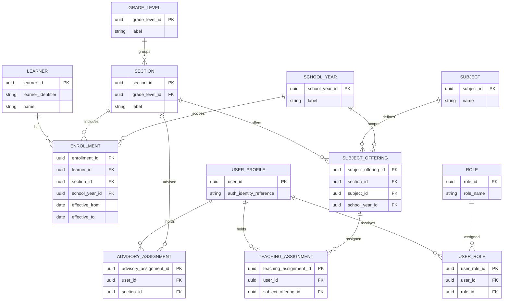
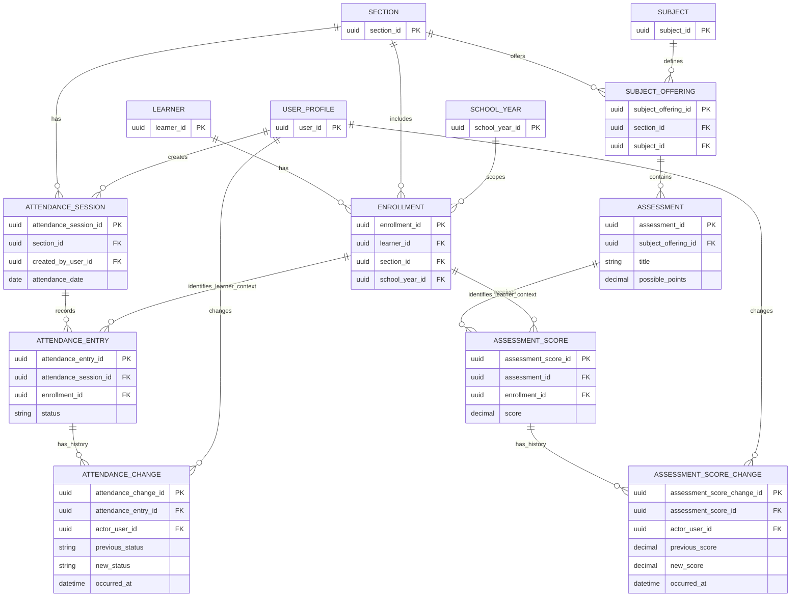
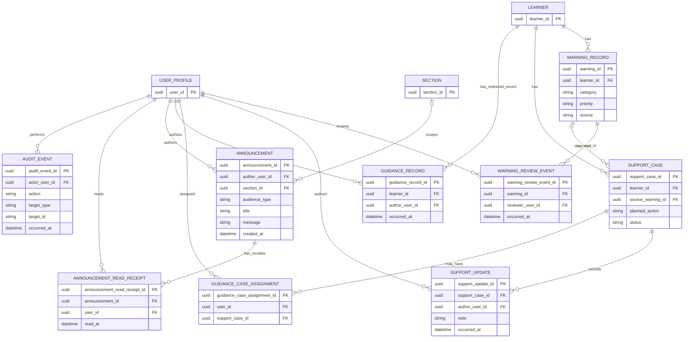

# Initial Data Model ERD

## Purpose and scope

This is a conceptual ERD for the current generic prototype and
the data relationships needed for a future shared backend. It is a design
proposal, not an approved institutional policy or a finalized schema. Fields and enum
values shown are illustrative; confirm them before implementation. The
prototype currently uses fictional demo account selection and browser-local
stores; it has no database, real authentication, or backend authorization.

The generic product identity is **Student Monitoring System**. The diagrams cover
school structure, learners and historical enrollment, staff identity and
assignments, attendance, academics, warning review, support follow-up,
announcements, and audit history. Dashboard summaries and reports are derived
from these records rather than stored as independent learner data.

## Mermaid ERD diagrams

### School structure, learner enrollment, and staff assignments

`SCHOOL_YEAR` and school-year links are conditional on confirming the
deployment's school-year model and its use in enrollment and subject offerings.
`SUBJECT_OFFERING` represents a subject available to a section; the current
prototype has only synthetic subjects and does not model offerings or staff
assignments. The proposed teaching, advisory, and guidance assignments are
separate from `ROLE`: a role alone does not establish access to a particular
class, subject, learner, or case. `GUIDANCE_CASE_ASSIGNMENT` is shown as a
restricted, approval-dependent assignment and is linked to the support-case
domain below.

`ENROLLMENT` preserves each learner's section history. Its effective dates
are design placeholders for representing when an assignment applies, not
school-defined date rules. Keep a learner's prior enrollment when they
transfer; do not rewrite old attendance or scores as if they belonged to the
new section.

### Attendance and academic records

An attendance session groups entries for a section and date and records its
creator for provenance. Whether a section can have multiple sessions per day
remains an open school workflow question; do not make `(section_id,
attendance_date)` unique until authorized deployment representatives confirm that one daily session is the
intended rule. If multiple sessions are permitted, their discriminator and
duplicate rule must be approved before adding a constraint. An attendance
entry references the enrollment that was in effect, rather than only the
learner's current section.

The first backend workflow must verify the authenticated identity, active role,
and applicable teaching or advisory assignment before reading a roster or
writing a session. A role alone is not scope. Teacher recording is conditional
on deployment institution approval; adviser recording is also pending confirmation. Guidance
Counselor, Parent/Guardian, and Designated System Administrator receive no
general attendance-table access in this workflow. Any future referral or
guardian summary is a separate, approval-dependent surface and must not imply
direct access to attendance tables.

Create entries under the session and applicable historical enrollment in one
transaction-safe operation. Enforce one entry per `(attendance_session_id,
enrollment_id)` and validate that the enrollment belongs to the session section
and is effective on its date. Corrections append an `ATTENDANCE_CHANGE` with
actor, previous/new statuses, and occurrence time. Whether initial entry
creation also produces a history event remains unresolved.

An assessment belongs to a section/subject offering, and each score refers to
the learner's applicable enrollment. Validate that the enrollment's section
matches the attendance session or assessment offering and that its effective
period applies. Candidate uniqueness rules are one attendance entry per
enrollment/session and one score per enrollment/assessment; confirm edge cases
before setting database constraints. Status values and grading rules remain
unapproved; no official grade calculation is represented.

### Warning review, support, announcements, and audit

The nullable `SUPPORT_CASE.source_warning_id` retains the actual warning
relationship when a case starts from a warning; general follow-up may have no
source warning. The current prototype displays and saves source text rather
than a stable warning reference. The diagram allows a warning to be linked to
multiple cases; whether the school requires a different cardinality is open.
Review events preserve who reviewed a warning and when instead of reducing
review to a single mutable boolean.

An announcement may target a section when `audience_type` denotes a
section-scoped audience; otherwise its section reference is empty. The
prototype's staff/section audience label is not an authorization rule.
`ANNOUNCEMENT_READ_RECEIPT` records read state per user, with a candidate
uniqueness rule for announcement/user. The current prototype has one shared
read boolean and no user identity.

`AUDIT_EVENT` records actor, action, time, and a typed target identifier.
Its target is intentionally generic in this conceptual ERD and is not shown
as a foreign key. Phase 2.3 must decide how to enforce target integrity
(for example, domain-specific history records or a reviewed audit-target
design); do not treat the generic identifier as a referential constraint.
Important record corrections should remain attributable and historically
reviewable.

## Historical-data and integrity considerations

- Use stable internal identifiers; do not use array positions or generated
  session counters as persistent identifiers. The displayed learner IDs in
  the prototype are synthetic and the official identifier format is not yet
  confirmed.
- Preserve enrollment history and make attendance/scores refer to the
  enrollment context applicable when each record was made.
- Enforce section consistency between enrollment and the related attendance
  session or subject offering.
- Prevent duplicate attendance entries and duplicate scores for the same
  applicable session/activity; finalize exact uniqueness with the approved
  session and enrollment rules.
- Preserve prior attendance and score values when authorized corrections
  occur. Current prototype saves overwrite values; the capped attendance
  summary is not a full change audit.
- Keep attendance and score correction history linked to the changed record
  and the acting user, with before/after values and time, once authenticated
  identities are available.
- Retain warning review events and support updates as history rather than
  overwriting the only review/update state.
- Keep announcement read state per account, not as one shared property.
- Avoid cascade deletion of educational history. Define archival, correction,
  and retention behavior only after school review.
- Build overview metrics and reports as permission-scoped queries over their
  source records. They are not separate student facts.

## Conditional or deferred entities

- **School year, terms, and effective enrollment dates:** likely relevant for
  preserving history, but exact school-year and term structures require deployment
  confirmation.
- **Subject offerings, staff roles, and assignments:** needed for a future
  scoped multi-role workflow; exact roles, assignments, and authority are
  provisional. Authentication identities and user/role assignments do not
  exist in the prototype.
- **Warning rules/evidence and notification records:** only after warning
  categories, evidence, thresholds, review/escalation procedure, and
  notification recipients are approved. Current warnings are synthetic
  prompts, not generated classifications.
- **Restricted guidance records:** shown as a separate entity only if the deployment institution
  approves collection and handling. They must not be copied into ordinary
  support updates or exposed by general case access.
- **Guardian links and parent accounts:** excluded from the core ERD until
  guardian identity/relationship verification, approved visibility, and
  communication procedures are decided.
- **Attachments, absence reasons, behavior observations, track/strand,
  external messages, and saved report runs:** not represented as core entities;
  include only if the corresponding workflow and purpose are confirmed.
- **Sync metadata/outbox and offline records:** deferred to the later offline
  design; they do not replace the authoritative records or authorization
  model.

## Open design questions for the next phase

1. What are the approved learner identifier, profile fields, gender/sex
   terminology, and access purpose?
2. How are school years, terms, grade levels, sections, subjects, and
   applicable offerings defined? Can a section have multiple attendance
   sessions per day?
3. What attendance statuses, correction history, and retention rules apply?
4. Which academic activity fields and score correction history are required?
   Which official grading rules apply, if any?
5. What warning categories, evidence, review actions, assignment scope, and
   escalation are approved?
6. Can a support case relate to more than one warning? Which roles can see
   each case field/update, and what must remain guidance-only?
7. Which staff roles and class/subject/advisory/caseload assignments are
   approved, and who provisions them?
8. Which announcement audiences are allowed, and should reads be tracked per
   account or by another approved mechanism?
9. Which correction, audit, archival, retention, recovery, and export actions
   must be recorded, and how should audit targets maintain referential
   integrity?

This ERD is an input for Phase 2.3's data dictionary and review, not
authorization to create schema migrations or implement backend behavior.
